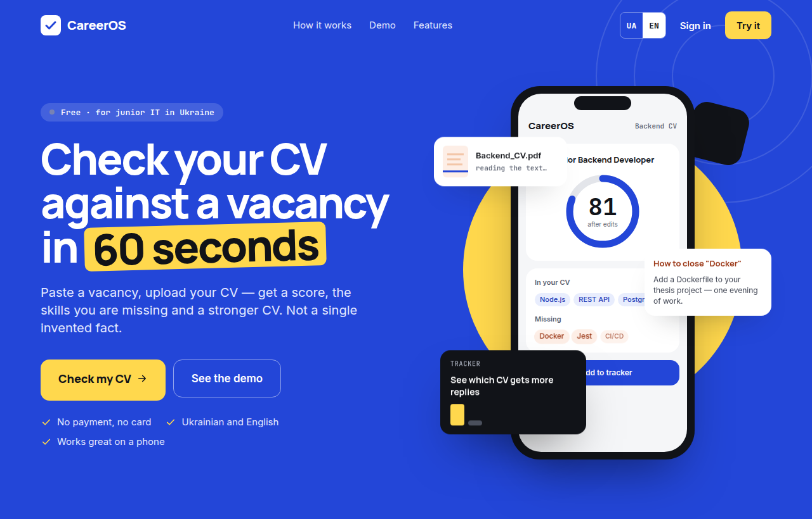
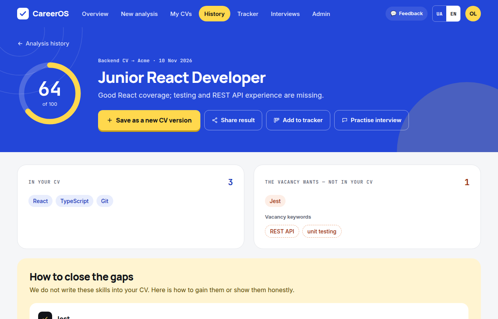
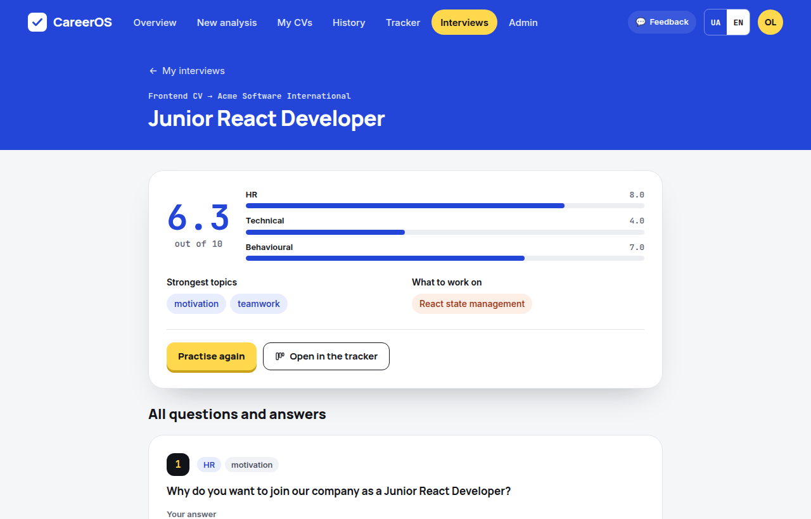
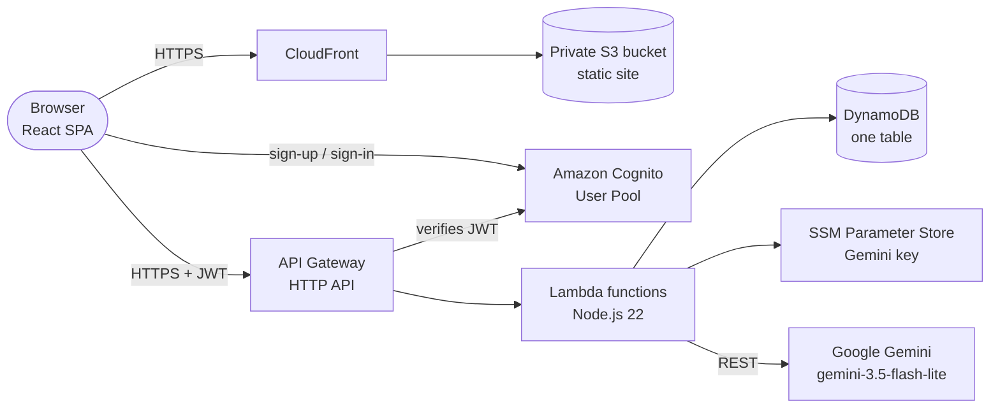

<div align="center">

# CareerOS

### A free AI career assistant for junior IT job seekers in Ukraine

[](https://github.com/MaksIMMum/CareerOS/actions/workflows/ci.yml)
[](#prerequisites)
[](#cost-free-tier)

**Live:** <https://d34opbkbhqypsa.cloudfront.net>



</div>

## What it is and who it's for

CareerOS helps students and junior IT specialists in Ukraine land their first job. It is free and works in
Ukrainian (default) and English.

| Feature | What you get |
| --- | --- |
| **CV vs vacancy analysis** | Paste a vacancy, upload your CV (PDF, read in the browser) and get a match score, the skills and keywords you are missing, and advice on how to close each gap. |
| **Honest CV rewrite** | Your CV reordered and reworded for that vacancy. The AI may only rephrase facts that are already in your CV; anything new is flagged for you to check. |
| **Cover letter** | A short cover letter for the vacancy in Ukrainian or English, written only from facts in your CV and checked the same way. Edit it, copy it or download it as PDF. |
| **Skills to learn** | On the dashboard: the skills vacancies asked for most often across your analyses that your CV lacked (e.g. "Docker — 7 of 9"), with the ones you have since added marked. |
| **Chrome extension** | A side panel on Djinni / DOU / Work.ua vacancy pages: match the vacancy with your CV, get the improved CV as PDF and a cover letter without leaving the job site. See [Chrome extension](#chrome-extension). |
| **Vacancy from a link or PDF** | Paste a Djinni or DOU vacancy link and the form fills itself in (Work.ua often blocks automatic reading — then paste the text), or upload the vacancy as a PDF (read in your browser). |
| **Djinni / LinkedIn profile text** | On "My CVs": a headline, an "About" text and a skills list for your Djinni or LinkedIn profile, written only from that CV and checked the same way, with copy buttons. |
| **CV and vacancy as PDF** | Download any saved CV version, or the vacancy you analysed, as a clean black-and-white A4 PDF (works with Ukrainian text). |
| **Share card** | A public before → after score card (no CV text) to share with friends. |
| **Application tracker** | A board (Applied → Interview → Offer → Rejected) that remembers which CV version you sent, and shows which version gets more replies. |
| **Mock interview** | 6–8 HR, technical and behavioural questions built from the vacancy and your CV, a score and feedback for every answer, and a better example answer that never invents experience. |
| **Admin metrics** | For the team: sign-ups, real use, return rate, sources, feedback and donations, with an anonymised CSV export. |

| Analysis result | Mock interview result |
| --- | --- |
|  |  |

## Architecture



- **Frontend:** React + Vite + TypeScript + Tailwind, i18next (UA/EN), pdf.js (CV text is extracted in the browser).
- **Backend:** one small Lambda per resource behind an API Gateway HTTP API with a Cognito JWT authorizer.
- **Data:** a single DynamoDB table; every user's data lives in their own partition.
- **AI:** Google Gemini over REST, behind a small provider interface; every prompt forbids inventing experience.
- **Infrastructure as code:** AWS CDK (TypeScript) in `infra/`.

Data model, API routes, AI client and security notes: [`docs/technical-reference.md`](docs/technical-reference.md).

## Repository structure

```text
.
├── backend/            Lambda handlers (TypeScript) + Vitest tests
│   ├── src/handlers/   one file per API resource: cvs, analyses, interviews, applications, admin, …
│   └── src/lib/        shared code: DynamoDB, AI client (llm.ts), prompts, quota, validation
├── extension/          Chrome extension (Manifest V3 side panel) — reuses frontend/src code
├── frontend/           React app (Vite, Tailwind, i18next)
│   ├── src/pages/      one file per page
│   └── src/locales/    uk.ts + en.ts (all user-facing text)
├── infra/              AWS CDK stack, deploy script, Gemini key script
├── scripts/smoke.mjs   smoke test of a deployed site (npm run smoke)
├── docs/               technical reference, report template, demo script, screenshots
├── CHANGELOG.md        including "Changes from user feedback"
├── BUGS.md             bugs reported by users
└── CLAUDE.md           project rules (free tier only, UA+EN, no invented CV facts, no secrets)
```

## Prerequisites

- **Node.js 22+** and npm, and git
- An **AWS account** and the **AWS CLI v2**, signed in (`aws configure` or `aws configure sso`)
- A **Google account** for a free Gemini API key
- Nothing to install globally: the AWS CDK comes with the project (`npx cdk`)

## Run locally

```bash
git clone https://github.com/MaksIMMum/CareerOS.git
cd CareerOS
npm ci
npm run lint && npm run typecheck && npm test   # all checks
npm run dev                                       # http://localhost:5173
```

Without a deployed backend only the public pages work (landing, sign-in form, privacy). To use the whole app
locally against **your** deployed stack:

1. Deploy once with `ALLOW_LOCAL_DEV=1` (see below) so the API accepts requests from `http://localhost:5173`.
2. `cp frontend/.env.production frontend/.env.local` (the deploy writes the API and Cognito ids there).
3. `npm run dev`.

## Chrome extension

The extension brings CareerOS to the moment you apply: open a vacancy on **Djinni, DOU or Work.ua**, click the
CareerOS icon, and a side panel reads the vacancy from the page, matches it with one of your CVs, and gives you
the score, missing skills, an honest CV rewrite (download as PDF) and a cover letter. It signs in with the same
account as the website and uses the same API; CVs are managed on the website.

**Build and install (unpacked):**

```bash
npm run deploy                 # once: writes frontend/.env.production (API, Cognito, site URL) used by the build
npm run build:extension        # → extension/dist
```

Then in Chrome open `chrome://extensions`, turn on **Developer mode**, click **Load unpacked** and choose
`extension/dist`. Pin the CareerOS icon and click it on a vacancy page.

- The manifest is generated at build time (`extension/manifest.ts` + `manifest.base.json`): it adds your API's host
  from `frontend/.env.production` to `host_permissions`, which is how the side panel calls the API (API Gateway CORS
  does not accept `chrome-extension://` origins). Rebuild the extension after deploying to a new stack.
- The extension id is fixed by the public `key` in `extension/manifest.base.json` (`pnbpcifonoheffgdhbaocjkffeklejli`).
- Permissions: `sidePanel`, `scripting`, `storage`, the three job sites and your CareerOS API only. The page is read only while the
  panel is open; nothing is sent until you press "Match my CV".
- Publishing to the Chrome Web Store (later) needs a one-time $5 developer registration; the AWS side stays free.

## Deploy from a fresh AWS account

Everything runs in `us-east-1`. Steps 1–3 are done once per account.

**1. Check that the AWS CLI is signed in to the right account**

```bash
aws sts get-caller-identity          # shows the Account id; use AWS_PROFILE=<name> if you have several
```

**2. Bootstrap the AWS CDK** (creates a small "CDKToolkit" stack the CDK needs)

```bash
cd infra
npx cdk bootstrap aws://<ACCOUNT_ID>/us-east-1
cd ..
```

**3. Store the Gemini API key in SSM Parameter Store**

Create a free key at <https://aistudio.google.com/apikey> (don't enable billing). Then run:

```bash
npm run set-gemini-key
```

It asks for the key with masked input and saves it as an encrypted `SecureString` named
`/careeros/gemini-api-key`. Run it again to change the key. Never put the key in code, `.env` files or
GitHub workflows.

**4. Deploy the backend and the website**

```bash
ALERT_EMAIL=you@example.com npm run deploy
```

| Variable | Required | Meaning |
| --- | --- | --- |
| `ALERT_EMAIL` | yes | Gets the AWS budget alert (any real spend, 1 USD monthly budget). Confirm the subscription e-mail AWS sends. |
| `TEAM_EMAILS` | no | Comma-separated team accounts that `/admin` can exclude from the metrics. Never committed (the repo is public). |
| `ALLOW_LOCAL_DEV` | no | `1` also allows `http://localhost:5173` in CORS, for local frontend development. |
| `VITE_DONATION_URL` | no | Another Monobank jar for the donation prompt (default: the CareerOS jar in `frontend/src/lib/donation.ts`). |

The script builds the frontend, deploys the `CareerOsStack`, writes the API and Cognito ids to
`frontend/.env.production`, rebuilds and uploads the site, and prints the site URL. The first deploy takes
about 5–10 minutes (CloudFront); later ones about 1–2 minutes.

**5. Check the deployment**

```bash
npm run smoke
```

It checks `/health`, that the site answers 200 over HTTPS, that `http://` redirects, that protected routes
need a login, and that CORS only allows the site. All 10 checks should pass.

**6. Make yourself an admin** (for the `/admin` metrics page)

Sign up on the site first, then:

```bash
aws cognito-idp admin-add-user-to-group --region us-east-1 \
  --user-pool-id <UserPoolId from the deploy output> --username <your sign-in e-mail> --group-name admins
```

Sign out and in again so your session carries the group, then open `<site>/admin`. The `admins` group is
created by the stack.

### Deploy from GitHub Actions (optional)

`.github/workflows/deploy.yml` runs from **Actions → Deploy to AWS → Run workflow**. It needs the repository
secret `AWS_ROLE_ARN` (an IAM role trusted by GitHub's OIDC provider, so no long-lived AWS keys), the
`alert_email` input, optionally the `TEAM_EMAILS` secret, and steps 2–3 above done in the account.
CI (`.github/workflows/ci.yml`) runs lint, type-check, tests and the build on every push and pull request.

## Cost (free tier)

CareerOS is built to cost **0 USD** for a student project:

| Service | How it stays free |
| --- | --- |
| DynamoDB | Provisioned 5 read / 5 write units — within the always-free 25 units |
| Lambda | Always-free 1M requests and 400,000 GB-s a month (256 MB ARM functions) |
| CloudFront | Always-free 1 TB transfer and 10M requests a month |
| Cognito | The free tier covers far more monthly users than this project has |
| API Gateway (HTTP API) | 1M requests a month free for the first 12 months; about 1 USD per million after that |
| S3, CloudWatch Logs, SSM | A few MB of site files; logs are kept 2 weeks; standard SSM parameters are free |
| Google Gemini | Free tier of the Gemini API (no billing account). On the free tier Google may use prompts to improve its products, so the app tells users not to upload sensitive personal data. |

No NAT gateways, RDS or Secrets Manager are used. A 1 USD monthly budget sends an e-mail on any real spend.
For that budget to count CareerOS resources, activate the `project` cost-allocation tag once in
**Billing → Cost allocation tags**. Each user also has a daily AI limit (10 analyses, 5 interviews, 10 shares, 10 cover letters, 10 profile texts, 30 vacancy imports).

## Destroy

```bash
npm run destroy --workspace=infra
```

This removes the website, API, Lambdas, logs and budget. To protect user data, the **DynamoDB table** and the
**Cognito User Pool** are kept; delete them when you are sure:

```bash
aws dynamodb delete-table --region us-east-1 --table-name careeros
aws cognito-idp delete-user-pool --region us-east-1 --user-pool-id <UserPoolId>
aws ssm delete-parameter --region us-east-1 --name /careeros/gemini-api-key
```

The `CDKToolkit` stack from step 2 can stay (it costs nothing when idle) or be deleted in CloudFormation.

## Project rules

See [`CLAUDE.md`](CLAUDE.md): AWS and Gemini free tier only; every user-facing text in Ukrainian and English;
AI may never invent CV experience or skills; no secrets in code or git; keep this README current.

## More docs

- [`docs/technical-reference.md`](docs/technical-reference.md) — data model, API, AI client, security notes
- [`docs/report-template.md`](docs/report-template.md) — the user-feedback report to fill in
- [`docs/demo-script.md`](docs/demo-script.md) — 3-minute demo
- [`CHANGELOG.md`](CHANGELOG.md) · [`BUGS.md`](BUGS.md)

## Team

Built for the OOAD course by [MaksIMMum](https://github.com/MaksIMMum),
[VitaliiVoloskyi](https://github.com/VitaliiVoloskyi) and [OrGreeM](https://github.com/OrGreeM).
